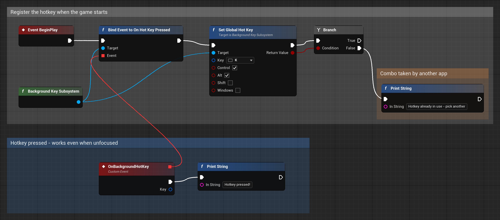

# Unfocused Hotkeys

An Unreal Engine plugin that fires a Blueprint event when a global hotkey is pressed, **even while your game is not focused**. You can use it for stream-deck style controls, overlay toggles, "panic" keys, or anything else that should react while the player is alt-tabbed into another app.

Originally made for the YouTuber NeoCranium, now released for everyone to use.



- Pure Blueprint workflow: no C++ needed to use it.
- Any key from the supported list, plus any combination of Ctrl / Alt / Shift / Win.
- Tells you when Windows refuses a combo because another app already owns it.
- Lightweight: one background thread waits on Windows messages, and it uses no CPU between key presses.

> **Windows only (Win64).** It uses the Win32 `RegisterHotKey` API.

## Installation

### Option A: prebuilt (recommended)

1. Download the zip that matches your engine version from the [Releases](../../releases) page, for example `UnfocusedHotkeys-1.0.0-UE5.8-Win64.zip`.
2. Close the Unreal Editor.
3. Extract the zip into your project's `Plugins` folder (create the folder if it doesn't exist). You should end up with:
   ```
   YourProject/
   └── Plugins/
       └── UnfocusedHotkeys/
           └── UnfocusedHotkeys.uplugin
   ```
4. Open your project. Under **Edit → Plugins → Input**, check that **Unfocused Hotkeys** is enabled, then restart if the editor asks you to.

Prebuilt binaries only work with the engine version named in the zip. If your version isn't listed, use Option B.

### Option B: from source

Clone or download this repository into `YourProject/Plugins/UnfocusedHotkeys`, then open the project. When Unreal asks to rebuild the missing module, click **Yes**. This needs Visual Studio with the **Game development with C++** workload.

> **Packaging your game:** like any plugin that contains C++ code, packaging a project that uses it needs the Visual Studio C++ toolchain installed. That includes Blueprint-only projects.

## Quick start

You can put this in a Level Blueprint, a Player Controller or a Game Instance:

1. **Event BeginPlay**. Right-click, search for **Background Key Subsystem** and add the getter node.
2. **Bind Event to On Hot Key Pressed**. Drag the red **Event** pin out and choose **Add Custom Event**. That custom event fires every time the hotkey is pressed.
3. **Set Global Hot Key**: pick a key and tick the modifiers you want (for example Ctrl + Alt + K).
4. **Branch** on the return value. `False` means the key isn't supported or another app already uses that combo, so pick a different one.

To turn the hotkey off, call **Disable Global Hot Key**. It also turns off automatically when the game instance shuts down.

**Testing in the editor:** turn off **Edit → Editor Preferences → General → Performance → Use Less CPU when in Background**. If you don't, the editor throttles itself when unfocused and the event will look delayed. Press Play, click another window, and press your combo.

## Blueprint reference

All nodes live on the **Background Key Subsystem** (a Game Instance Subsystem), under the **Background Keys** category.

| Node | Type | Description |
|---|---|---|
| **Set Global Hot Key** (Key, Control, Alt, Shift, Windows) → bool | Function | Registers the hotkey and replaces any previous one. Returns `false` if the key isn't supported or Windows refused the combo. |
| **Disable Global Hot Key** | Function | Unregisters the current hotkey. |
| **Get Global Hot Key** → Key | Pure | The currently registered key, or None. |
| **On Hot Key Pressed** (Key) | Event | Fires on the game thread each time the hotkey is pressed. Holding the key does not repeat it. |
| **On Registration Changed** (bRegistered) | Event | Fires when the hotkey becomes active (`true`) or inactive (`false`). |

### Supported keys

A–Z, 0–9, F1–F12, Space, Enter, Escape, Tab, Backspace, Insert, Delete, Home, End, Page Up, Page Down, the four arrow keys, Caps Lock, and `, . - = [ ] \ / ; ' ~`.

## Things to know

- **The hotkey is captured system-wide.** While it's registered, other apps won't receive that key combo. Use modifiers (for example Ctrl + Alt + K) rather than a bare key, or the player won't be able to type that letter anywhere else.
- **One hotkey per game instance.** Calling **Set Global Hot Key** again replaces the previous one.
- **Some combos are reserved.** Windows keeps many Win-key shortcuts for itself, and other apps (Discord, OBS, and so on) may already own a combo. In both cases **Set Global Hot Key** returns `false`.
- **Win64 only.** The module doesn't load on other platforms, so keep Blueprints that use it out of builds for other platforms.

## License

[MIT](LICENSE) © 2026 Jenn.zip
